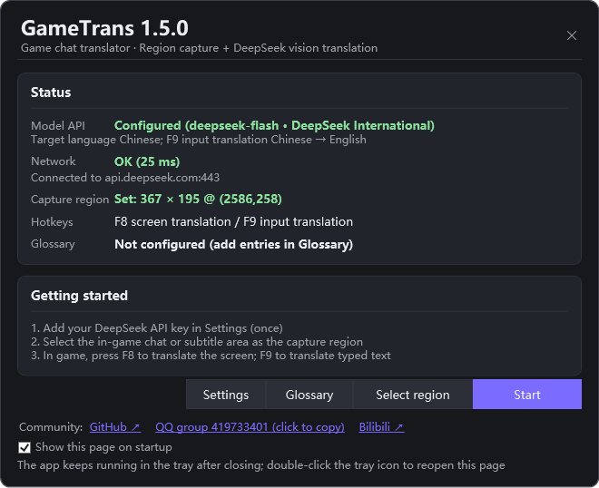
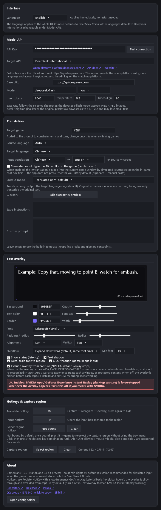
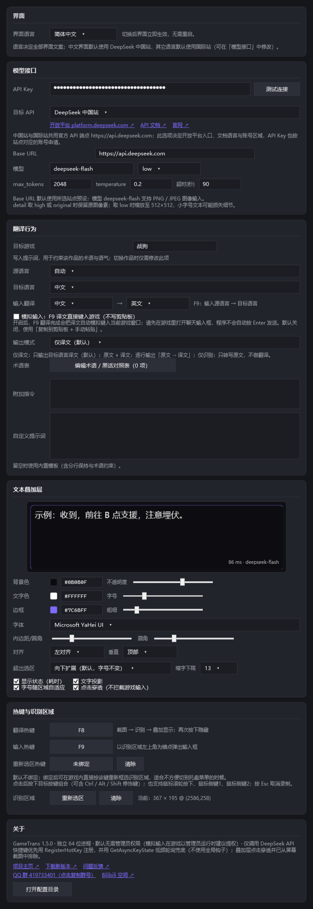
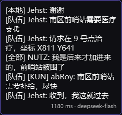
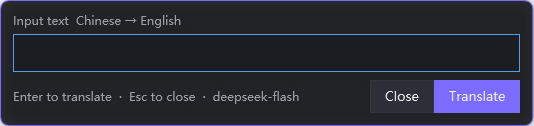
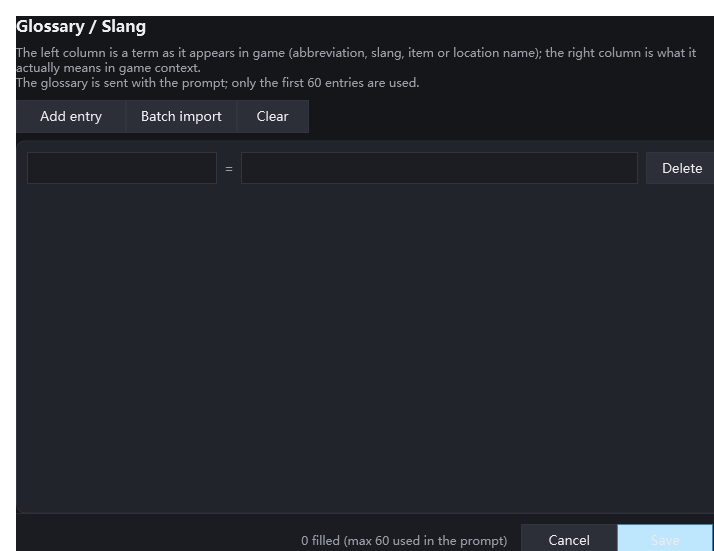

# GameTrans

[简体中文](README.md) | **English**

A real-time chat translator for PC games. It captures a chosen screen region with a hotkey and sends it to the DeepSeek vision model for OCR and translation, then draws the result in place as a configurable overlay. A separate input-translation channel translates text you type and copies the result to the clipboard — or, optionally, types it straight into the game.

- Standalone 64-bit process, single-file self-contained build, **no administrator rights required by default** (simulated input may need an elevated restart when the game / accelerator runs elevated)
- No dependency on the game client, account system or accelerator software
- Click-through overlay that never steals focus; it can be excluded from screen capture / recording (turn that off to keep NVIDIA Instant Replay working)
- UI switchable between **简体中文 / English**; translation direction and target API are dropdowns

Current version: **1.6.1** · Project: [github.com/ab-Royo/GameTrans](https://github.com/ab-Royo/GameTrans) · QQ group: **419733401** · Bilibili: [ab_Roy's channel](https://m.bilibili.com/space/51952428)

## Contents

- [Features](#features)
- [Screenshots](#screenshots)
- [Requirements](#requirements)
- [Quick start](#quick-start)
- [Usage](#usage)
- [Configuration](#configuration)
- [How it works](#how-it-works)
- [Build & release](#build--release)
- [Command-line options](#command-line-options)
- [FAQ](#faq)
- [Privacy & security](#privacy--security)
- [Community](#community)
- [Disclaimer](#disclaimer)
- [License](#license)

## Features

| Capability | Details |
|---|---|
| Region capture | Full-screen frozen screenshot with drag selection; multi-monitor and mixed-DPI aware |
| Screen translation | Default `F8`: capture → vision model OCR + translation → overlay; press again to hide |
| Input translation | Default `F9`: input box anchored to the capture region, translated in the configured direction and copied |
| Simulated input | Optional setting: after the F9 translation, type the result straight into the game without using the clipboard; blocked when the game / accelerator runs elevated, in which case the app offers an elevated restart |
| Select-region hotkey | Optional global hotkey to re-select the capture region in-game; unbound by default |
| Network diagnostics | Distinguishes DNS failure, unreachable endpoint, connect timeout and TLS failure, with accelerator / VPN / proxy / DNS suggestions; the startup page shows live network status |
| UI language | One-click 简体中文 / English switch in Settings; every UI string updates immediately |
| Translation direction | Source: auto / Chinese / English / Korean / Japanese; target: Chinese / English / Korean / Japanese (screen and F9 directions are independent) |
| Target API | DeepSeek China / DeepSeek International, default follows the UI language, with links to the open platform, API docs and website |
| Hotkey binding | Keyboard keys plus mouse middle button, side button 1 and side button 2, optionally with `Ctrl` / `Alt` / `Shift`; a polling fallback kicks in when registration fails or a game swallows the key |
| Overlay style | Background color/opacity, text color, font family/size, padding, corner radius, border and alignment are configurable; the overlay can optionally be excluded from capture (needed off for NVIDIA Instant Replay) |
| Overflow strategy | Extend downward by default (same font size), or shrink to fit the region |
| Glossary | Hand-maintained term → meaning table injected into the prompt to constrain game-specific wording |
| Startup page | Summarizes model API, network, capture region, hotkeys, glossary and permission warnings, with shortcuts to each setting; opens on tray double-click |
| Headless self-test | `--selftest` verifies config, capture, off-screen rendering, request body, prompts, language/site normalization, network error classification and the region-hotkey default |

## Screenshots

**Startup page**



**Settings (English)**



**Settings (简体中文)**



**Text overlay** (formatted for a 370 × 130 capture region)



**Input translation (F9)**



**Glossary / slang table**



## Requirements

- Windows 10 2004 or later (the default **Exclude overlay from capture** option relies on `WDA_EXCLUDEFROMCAPTURE`; turning it off removes that requirement)
- x64 architecture
- A valid DeepSeek API key (use a model with image input; `deepseek-flash` by default)

Building requires the [.NET 9 SDK](https://dotnet.microsoft.com/download/dotnet/9.0); running does not require the runtime (published as a self-contained single file).

Use **borderless windowed** or windowed mode for the game. Exclusive fullscreen usually produces black screenshots and may hide the overlay.

## Quick start

1. Download `GameTrans.exe` from [Releases](https://github.com/ab-Royo/GameTrans/releases).
2. Launch it and click **Settings** on the startup page:
   - pick the UI language (简体中文 / English) in the **Interface** card;
   - check the **Target API** in the **Model API** card (default follows the UI language), paste your DeepSeek API key and click **Test connection**;
   - adjust the source / target languages as needed (dropdowns; the source language can be **Auto**).
3. Click **Select region** on the startup page, drag over the in-game chat or subtitle area and press Enter. To re-select in-game later, bind the optional **Select-region hotkey** in Settings → **Hotkeys & capture region** (unbound by default).
4. Back in game:
   - press `F8` to translate the current screen, press again to hide;
   - press `F9`, type your text and press Enter — the translation is copied to the clipboard for pasting; with **Simulated input** enabled in Settings it is typed straight into the in-game chat box instead (restart GameTrans as administrator when the game itself runs elevated).

After the first setup the app stays in the system tray. **Double-click the tray icon to open the startup page.** The tray menu can translate, re-select the capture region, open the glossary, run network diagnostics, open Settings or exit.

## Usage

### Screen translation (default F8)

```
F8 ─┬─ overlay visible ─────────────────► hide and cancel in-flight request
    └─ hidden ─┬─ no capture region ─────► open the region picker, then continue
               └─ region set ───────────► capture → overlay shows "Recognizing…"
                                          → vision model OCR + translation
                                          → overlay shows translation and latency
```

- The overlay is anchored to the capture region's top-left corner and matches its width; it extends downward when the translation is taller.
- Request failures are shown in the overlay instead of failing silently.
- The direction comes from **Source language / Target language** in Settings; default `Auto → Chinese`.

### Input translation (default F9)

```
F9 ─► translucent input box anchored to the capture region
    ─► type text → Enter
    ─► model translates in the configured direction → clipboard → result shown in the box
    ─► auto-closes after 3 s (any key cancels); Enter closes immediately
```

The direction comes from the **Input translation** source / target languages; default `Chinese → English`, independent of the screen direction.

- The box actively grabs foreground keyboard focus. In games (borderless / exclusive fullscreen) a plain `Activate()` may be refused, so Enter / Esc would go to the game and the box could not be closed. Since 1.4.0 it uses `AttachThreadInput + SetForegroundWindow` with a short retry window, and stops retrying as soon as you switch back to the game.
- `Esc` / `Enter` work anywhere in the window (even after clicking a button). The window is positioned in physical pixels, so per-monitor DPI no longer causes "visible but unclickable" offsets.
- After a successful translation the box **always** auto-closes: 3 s when the copy succeeded, 5 s when the clipboard was busy (Enter retries the copy and closes immediately). Any key cancels the pending auto-close.
- If the clipboard is temporarily occupied by another app, the status bar says "Clipboard busy; not copied" and Enter still closes the box immediately.

### Simulated input (optional)

Entry: Settings → **Translation** → **Simulated input: type the F9 result into the game (no clipboard)**, off by default.

- When enabled, the F9 box shows the translation for a moment, then closes and types it into the current game window with `SendInput` (Unicode characters) instead of writing the clipboard — useful when the game cannot paste, or pasting triggers anti-cheat.
- Open the in-game **chat input box first**; the app does not press Enter for you, it only types the text. Line breaks and tabs in the translation are turned into spaces to avoid accidentally sending the message.
- The app first returns the foreground to the game and verifies the game window is focused again before typing. If it cannot switch back, or the game runs as administrator and blocks simulated input, it falls back to copying the translation to the clipboard and tells you.
- Global hotkeys are suspended while typing, so characters in the translation cannot trigger a bound hotkey.
- **When administrator rights are needed**: if the game or accelerator runs elevated, Windows (UIPI) blocks `SendInput` from a non-elevated process. Ticking simulated input shows a red warning right away; on save, a dialog explains the issue and offers **Restart as administrator** (or "Not now"). The app still starts unelevated by default — elevation is opt-in. Cancelling the restart keeps the setting saved and the clipboard flow working.

### UI language

Entry: Settings → **Interface** → **Language**.

- Switch between **简体中文 / English**. The change applies immediately; no restart needed.
- The Settings window rebuilds in place with the new language (other unsaved edits are kept); the startup page, tray menu, input box and glossary pick up the new language the next time they open.
- The language also drives the **Target API** default: Chinese → DeepSeek China, other languages → DeepSeek International.
- Stored as `ui.language` in the settings file.

### Target API (DeepSeek China / International)

Entry: Settings → **Model API** → **Target API**.

| Option | Default base URL | Open platform | API docs |
|---|---|---|---|
| DeepSeek China | `https://api.deepseek.com` | [platform.deepseek.com](https://platform.deepseek.com/) | [api-docs.deepseek.com/zh-cn](https://api-docs.deepseek.com/zh-cn/) |
| DeepSeek International | `https://api.deepseek.com` | [platform.deepseek.com](https://platform.deepseek.com/) | [api-docs.deepseek.com](https://api-docs.deepseek.com/) |

- DeepSeek officially serves both Chinese and overseas accounts from the **same endpoint**, `https://api.deepseek.com`. The two options differ in the open-platform entry, documentation language and account region (the international platform supports email sign-up and USD top-up); Settings shows the matching **Open platform / API docs / Website** links.
- Switching the option resets the base URL to that preset; a custom gateway can still be entered manually in Base URL and is not overwritten.
- Chinese UI defaults to China; other languages default to International. If you change the target API manually, switching the UI language will not override your choice.

### Network issues and diagnostics

With some accelerator modes (for example Thunder's "Mode 2"), VPNs or system proxies, DNS may be hijacked or stop working entirely: the game works, but browsers, `ping` and API requests all fail to resolve hosts. GameTrans translates those system errors into actionable messages:

- On startup it probes the network once (DNS + TCP, no HTTP data) and shows **Network** status on the startup page: OK / DNS lookup failed / unreachable / timed out, with advice when it fails.
- Tray menu → **Network diagnostics…** re-runs the probe on demand and shows the full result (endpoint, latency, cause and suggestions).
- When F8 hits a network error, the overlay no longer just says "No such host is known"; it states that DNS resolution failed and suggests: disable or switch the accelerator mode and retry, set the system DNS to `223.5.5.5` / `1.1.1.1`, and verify a browser can open `https://api.deepseek.com`.
- DNS failures are deterministic, so the client no longer retries them after 700 ms; the TCP connect timeout is capped at 8 seconds so pressing F8 does not leave the UI hanging.

### Hotkey binding

Entry: Settings → **Hotkeys & capture region**.

- Click **Translate hotkey** or **Input hotkey**, then press the desired combination; press `Esc` to cancel recording.
- **Select-region hotkey** is unbound by default: click it and press a combination; in game it opens the full-screen region picker directly. The adjacent **Clear** button unbinds it. No API key is required for this action.
- Keyboard keys (letters, digits, F-keys, arrows, `Home` / `End`, etc.) and three mouse buttons are supported: **middle button**, **side button 1** and **side button 2**.
- `Ctrl` / `Alt` / `Shift` / `Win` modifiers can be combined, e.g. `Ctrl+Mouse Side 1`.
- Keyboard hotkeys are registered with `RegisterHotKey` first, with a `GetAsyncKeyState` poll every 15 ms on a dedicated background thread as a fallback: some games (DirectInput / exclusive fullscreen) keep keys away from the message pump, so registration may succeed while `WM_HOTKEY` never arrives — or the hotkey is already owned by another program. The two channels de-duplicate the same physical press, so nothing fires twice; no global keyboard hook is installed.
- Mouse buttons can only be polled and cannot be intercepted, so **if the game binds the same mouse button, both respond**.

### Glossary / slang table

Constrains the translation of in-game abbreviations, slang, item and location names.

- Entry: startup page **Glossary**, tray menu **Glossary / Slang…**, or Settings → **Glossary**.
- Left column: the term; right column: what it means in this game.
- Batch import: one `term=meaning` per line; Tab or `|` also work.
- Up to 200 entries stored, the first 60 are sent in the prompt.

## Configuration

Config directory: `%APPDATA%\GameTrans\`

| File | Description |
|---|---|
| `settings.json` | All settings |
| `GameTrans.log` | Runtime log (rotated above 2 MB) |

Put a `portable.txt` next to the executable, or set the `GAMETRANS_DATA` environment variable, to use a portable/custom config directory.

<details>
<summary>Settings fields</summary>

| Group | Field | Description |
|---|---|---|
| `ui` | `language` | UI language: `zh` / `en`, default `zh` |
| `api` | `site` | Target API: `cn` China / `intl` International; empty or invalid follows the UI language |
| | `baseUrl` | Endpoint, default `https://api.deepseek.com` (custom gateways allowed) |
| | `model` | Model name, default `deepseek-flash` |
| | `apiKeyProtected` | DPAPI-encrypted API key (written by the app, never store plain text here) |
| | `detail` | `high` / `original` keep image detail; `low` downscales to 512×512 |
| | `maxTokens` / `temperature` / `timeoutSeconds` | Defaults 2048 / 0.2 / 90 |
| `prompt` | `gameName` | Target game, injected into the prompt to constrain terms and tone |
| | `sourceLanguage` / `targetLanguage` | Screen translation direction, language codes `auto` / `zh` / `en` / `ko` / `ja`, default `auto` → `zh` |
| | `inputSourceLanguage` / `inputTargetLanguage` | F9 direction, same codes (source may be `auto`), default `zh` → `en` |
| | `outputMode` | `translated` only translation / `bilingual` original + translation / `ocr` OCR only |
| | `glossary` | Glossary, an array of `{ term, meaning }` |
| | `extraInstruction` | Extra instructions; `systemPrompt` empty means the built-in template |
| `overlay` | `bgColor` / `bgOpacity` | Background color and opacity |
| | `textColor` / `fontFamily` / `fontSize` | Text style |
| | `padding` / `cornerRadius` / `borderColor` / `borderThickness` | Padding, corner radius, border |
| | `textAlign` / `verticalAlign` | Alignment |
| | `showStatus` / `textShadow` | Latency status, text shadow |
| | `autoScaleFont` / `minFontSize` | Font auto-scaling and its lower bound |
| | `overflowMode` | `expand` downward / `shrink` to fit |
| | `clickThrough` | Click-through |
| | `excludeFromCapture` | Exclude the overlay from capture / recording (`WDA_EXCLUDEFROMCAPTURE`), default `true`; when on, NVIDIA Instant Replay is force-stopped — set to `false` if you record with NVIDIA |
| `hotkeys` | `translateVk` / `translateMods` | Screen translation hotkey, default `F8` (`0x77`); mouse middle / side1 / side2 are `0x04` / `0x05` / `0x06` |
| | `inputVk` / `inputMods` | Input translation hotkey, default `F9` (`0x78`), same key codes |
| | `regionVk` / `regionMods` | Select-region hotkey, default `0` = unbound; same key codes |
| `region` | `left` / `top` / `right` / `bottom` | Capture region in virtual-desktop physical pixels |
| `behavior` | `showStartupWindow` / `inputOpacity` | Startup page toggle, input box opacity |
| | `showLatency` / `copyInputResult` / `simulateInput` | Latency display, auto-copy, simulated input (type F9 result into the game, default `false`; requires an elevated restart when the game / accelerator runs as administrator) |

> When upgrading from 1.2.x or earlier, legacy language names (such as `中文（简体）`, `English`, `自动识别`) are normalized to language codes automatically; no manual edits needed.

</details>

## How it works

```
┌──────────────┐   RegisterHotKey    ┌──────────────┐
│ Win32 hotkeys│ ──────────────────► │  TrayApp     │
└──────────────┘                     └──────┬───────┘
                                            │
                    ┌───────────────────────┼────────────────────────┐
                    ▼                       ▼                        ▼
            ┌──────────────┐        ┌──────────────┐        ┌────────────────┐
            │ ScreenCapture│        │ DeepSeekClient│       │ OverlayWindow  │
            │ GDI BitBlt   │ ─────► │ chat/completions │ ───► │ layered window │
            └──────────────┘  PNG   └──────────────┘  text  └────────────────┘
```

See [docs/DESIGN.md](docs/DESIGN.md) for capture coordinates, overlay styling, localization and target-API design, and known limitations.

## Build & release

```powershell
# Build (solution; can be opened directly in Visual Studio 2022 / Rider)
dotnet build GameTrans.sln -c Release

# Publish single file (win-x64 / self-contained) and run the self-test
powershell -ExecutionPolicy Bypass -File scripts/publish.ps1
```

The output lands in `dist/`; `GameTrans.exe` there is a self-contained single file ready to distribute.

Self-test:

```powershell
dist\GameTrans.exe --selftest .\out
```

## Command-line options

| Option | Description |
|---|---|
| `--selftest <dir> [--headless]` | Headless self-test, writes `report.txt` and intermediate files; `--headless` skips screen-related checks (CI) |
| `--set-key <API_KEY>` | Encrypt and save the API key |
| `--api-test <API_KEY>` | Text probe to verify connectivity |
| `--api-text <API_KEY> <text>` | Translate text in the F9 direction |
| `--api-vision <API_KEY> <image>` | Run vision translation on an image |
| `--lang <zh\|en>` | UI language for off-screen demos/self-test (used to generate bilingual screenshots) |
| `--demo-startup <png>` | Off-screen render of the startup page |
| `--demo-admin-prompt <png>` | Off-screen render of the simulated-input elevation prompt |
| `--demo-glossary <png>` | Off-screen render of the glossary |
| `--demo-settings <png>` | Off-screen render of the full settings page |
| `--demo-overlay <x> <y> <w> <h>` | Show the overlay at the given position |
| `--demo-compose <png> <w> <h>` | Lay out and off-screen render the overlay for a region size |
| `--demo-input <png>` | Off-screen render of the input box |
| `--demo-selector` | Briefly open the region selector for verification |

## FAQ

**After enabling an accelerator / VPN / proxy, browsers, `ping` and GameTrans all fail to resolve hosts (DNS failure)**
This is common when an accelerator rewrites system DNS but only proxies game traffic (Thunder "Mode 2", for example). GameTrans does not change your network settings, but it does: (1) show **DNS lookup failed** on the startup page and in tray → **Network diagnostics…**; (2) put actionable suggestions in the F8 overlay. Try disabling the accelerator or switching its mode and retrying; set the system DNS to `223.5.5.5` / `1.1.1.1`; verify a browser can open `https://api.deepseek.com` before pressing `F8`. If you must keep the accelerator mode, add the DeepSeek API domain to its direct / bypass list.

**Pressing F8 force-stops NVIDIA Instant Replay ("GameTrans is preventing desktop recording")**
By default the overlay carries `WDA_EXCLUDEFROMCAPTURE` (excluded from capture so its own translation is not re-recognized), and NVIDIA App / GeForce Experience desktop capture treats such a window as protected content, which force-stops Instant Replay. Since 1.6.0 the flag is optional: Settings → **Text overlay** → clear **Exclude overlay from capture**; the overlay is then hidden before each capture and restored afterwards, and NVIDIA recording keeps working (leave it on when you do not record). To keep the flag instead, open NVIDIA App with Alt+Z → Settings → Video capture and turn **Desktop capture** off so only the game is recorded. Instant Replay has to be re-enabled manually after it is stopped.

**Simulated input does not type into the game / saving Settings says administrator rights are required**
Simulated input uses `SendInput`; when the game or accelerator runs elevated, Windows (UIPI) blocks typing from a non-elevated process. Ticking simulated input shows a red warning, and saving offers **Restart as administrator**. You can also exit and right-click `GameTrans.exe` → **Run as administrator**. To stay unelevated, turn simulated input off and keep using clipboard + manual paste.

**Hotkeys do nothing (single-key F8 / F9 ignored by some games)**
Usually another program owns the hotkey (the game itself, recording/overlay tools, mouse drivers). Since 1.4.0 the app switches to a polling fallback automatically when `RegisterHotKey` fails or its callback never arrives, and says so in a toast; single keys generally keep working. If the game also binds the same key and both react, use a combination with modifiers (e.g. `Ctrl+F8`, `Alt+F9`). Mouse middle / side buttons cannot be registered with `RegisterHotKey` and are always polled.

**F9 box cannot be closed / Enter or Esc do nothing / close button hard to hit**
Fixed in 1.4.0: the box might never get real foreground focus in a game (the game holds the foreground lock), so Enter / Esc went to the game; and the old code only armed the 3 s auto-close when the copy succeeded, so a busy clipboard left the box open forever. The box now force-activates with a short retry, handles Enter / Esc at window level, always auto-closes after a successful translation (5 s when the copy failed), keeps status text from covering the buttons, and is positioned in physical pixels. If it still does not close, exit from the tray, restart, and attach `%APPDATA%\GameTrans\GameTrans.log` to your report.

**Nothing changed after switching to English?**
The language applies immediately and the Settings window rebuilds in place. Other open windows (startup page, input box) apply it the next time they open; if the startup page is open, it is rebuilt after saving. Make sure you clicked **Save**.

**Why do China and International use the same endpoint?**
DeepSeek officially serves Chinese and overseas accounts from `https://api.deepseek.com`. The two options select the open-platform entry, documentation language and account region; they do not change the API protocol. Use Base URL to point at a custom gateway if needed.

**Black screenshots / no overlay**
The game is in exclusive fullscreen or the frame is DRM-protected. Switch to borderless windowed mode.

**Translation text is too small**
Set **Overflow** to **Expand downward**, or increase the font size and disable **Auto-scale font to region** in Settings.

**API errors**
`401` invalid key; `402` insufficient balance; `429` rate limited (the client retries once); raise `timeoutSeconds` or shrink the capture region on timeouts.

**Multi-monitor and scaling**
Coordinates are virtual-desktop physical pixels; cross-monitor selections work and each monitor is converted with its own DPI.

## Privacy & security

- The API key is encrypted with Windows DPAPI and can only be decrypted by the current user.
- Screenshots are encoded to PNG in memory and sent only to the configured model endpoint; they are never written to disk.
- No telemetry, analytics or update checks.

## Community

- Project and issue tracker: [GitHub](https://github.com/ab-Royo/GameTrans) ([Issues](https://github.com/ab-Royo/GameTrans/issues))
- QQ group: **419733401** (click the number in the startup page, Settings or the tray menu to copy it)
- Bilibili: [ab_Roy's channel](https://m.bilibili.com/space/51952428)

## Disclaimer

- This project is not affiliated with or endorsed by any game publisher, accelerator product or model provider.
- The interaction model follows common practice among similar tools; the implementation and code are independently written.
- Using this tool may violate the terms of service of some games; assess account risk yourself.
- Model output may contain errors; API usage costs are borne by the user.

## License

[MIT](LICENSE)
