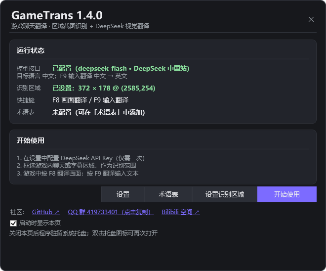
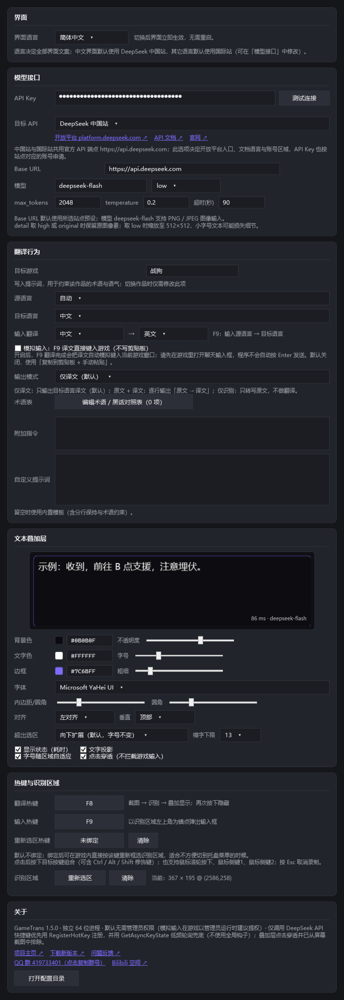
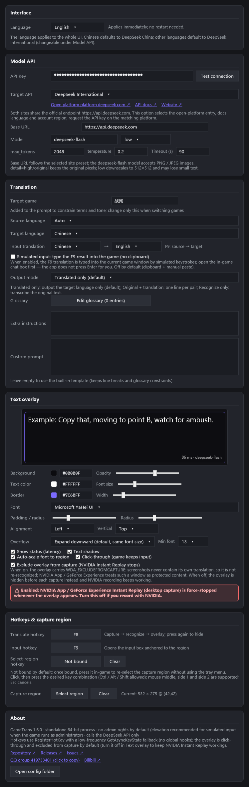
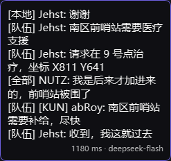
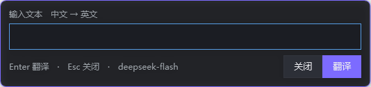
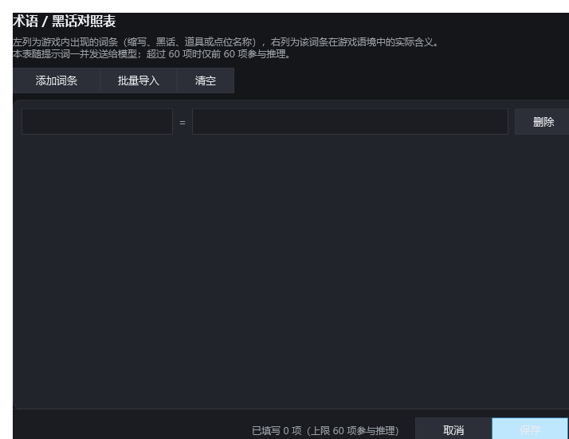

# GameTrans

**简体中文** | [English](README.en.md)

面向 PC 游戏的实时聊天翻译工具。以屏幕指定区域为识别范围，按快捷键截图并交由 DeepSeek 视觉模型完成文字识别与翻译，结果以可配置样式的文本层叠加在原位显示；另提供输入翻译通道，把输入的文本按设定方向翻译后写入剪贴板，或（可选）直接模拟键入游戏。

- 独立 64 位进程，单文件自包含发布，**默认无需管理员权限**（模拟输入在游戏 / 加速器以管理员运行时需提权重启）
- 不依赖游戏客户端、账号体系或加速器组件
- 叠加层点击穿透、不抢占焦点，可从屏幕截图 / 录制中排除（可关闭以兼容 NVIDIA 即时重放）
- 界面支持**简体中文 / English** 切换

项目主页：[github.com/ab-Royo/GameTrans](https://github.com/ab-Royo/GameTrans)　·　QQ 群：**419733401**　·　Bilibili：[ab_Roy 的个人空间](https://m.bilibili.com/space/51952428)

## 目录

- [功能概览](#功能概览)
- [界面](#界面)
- [环境要求](#环境要求)
- [快速开始](#快速开始)
- [使用说明](#使用说明)
- [配置](#配置)
- [工作原理](#工作原理)
- [构建与发布](#构建与发布)
- [命令行参数](#命令行参数)
- [常见问题](#常见问题)
- [隐私与安全](#隐私与安全)
- [社区](#社区)
- [免责声明](#免责声明)
- [许可证](#许可证)

## 功能概览

| 能力 | 说明 |
|---|---|
| 区域识别 | 全屏冻结截图 + 拖拽框选，支持多显示器与混合 DPI |
| 画面翻译 | 默认 `F8`：截图 → 视觉模型识别并翻译 → 叠加显示；再次按下隐藏 |
| 输入翻译 | 默认 `F9`：以识别区域左上角为锚点弹出输入框，按设定方向翻译并复制 |
| 模拟输入 | 设置项可开启：F9 翻译完成后直接把译文模拟键入游戏，不经过剪贴板；游戏 / 加速器以管理员运行时会被拦截，程序会提示以管理员身份重启 |
| 重新选区热键 | 可选绑定一个全局热键，在游戏内直接重新框选识别区域；默认不绑定 |
| 网络诊断 | 区分 DNS 解析失败、目标不可达、连接超时与 TLS 失败，给出加速器 / VPN / 代理 / DNS 设置等排查建议；启动页实时显示网络状态 |
| 界面语言 | 设置页一键切换 简体中文 / English，全部界面文案与提示立即生效 |
| 翻译方向 | 源语言：自动识别 / 中文 / 英文 / 韩文 / 日文；目标语言：中文 / 英文 / 韩文 / 日文（画面翻译与 F9 各自独立） |
| 目标 API | DeepSeek 中国站 / 国际站，默认跟随界面语言，附开放平台、API 文档与官网跳转链接 |
| 快捷键绑定 | 支持键盘按键与鼠标滚轮按下（中键）、鼠标侧键1、鼠标侧键2，可叠加 `Ctrl` / `Alt` / `Shift`；注册失败或在部分游戏内不生效时自动启用轮询兜底 |
| 文本叠加层 | 背景色/透明度、文字色、字体字号、内边距、圆角、边框、对齐方式均可配置；可选是否从截图 / 录制中排除（关闭后 NVIDIA 即时重放才能正常录制） |
| 溢出策略 | 文本超出识别区域时默认向下扩展（字号不变），可选缩放适配 |
| 术语表 | 手工维护「词条 → 含义」对照，随提示词下发以约束游戏内专有说法 |
| 启动页 | 汇总模型接口、网络、识别区域、快捷键、术语表状态与权限警示，并提供配置入口；双击托盘图标打开 |
| 无界面自检 | `--selftest` 校验配置、截屏、离屏渲染、请求体结构、提示词、语言/站点归一化、网络错误分类与选区热键默认值 |

## 界面

**启动页**



**设置（简体中文）**



**设置（English）**



**文本叠加层**（识别区域为 370 × 130 像素时的排版结果）



**输入翻译（F9）**



**术语 / 黑话对照表**



## 环境要求

- Windows 10 2004 或更高版本（默认开启的「从截图 / 录制中排除叠加层」依赖 `WDA_EXCLUDEFROMCAPTURE`；关闭该设置后不受此限制）
- x64 架构
- 可用的 DeepSeek API Key（使用支持图像输入的模型，默认 `deepseek-flash`）

构建需要 [.NET 9 SDK](https://dotnet.microsoft.com/download/dotnet/9.0)；运行无需安装运行时（发布为自包含单文件）。

游戏建议使用**无边框窗口化**或窗口化模式。独占全屏（Exclusive Fullscreen）下系统截图通常为黑屏，且叠加层可能无法显示。

## 快速开始

1. 从 [Releases](https://github.com/ab-Royo/GameTrans/releases) 下载 `GameTrans.exe`。
2. 双击运行，启动页点击「设置」：
   - 在「界面」卡片选择界面语言（简体中文 / English）；
   - 在「模型接口」确认目标 API（默认跟随界面语言），填入 DeepSeek API Key，点击「测试连接」确认连通后保存；
   - 按需调整源语言 / 目标语言（均为下拉框，源语言可设为「自动」）。
3. 启动页点击「设置识别区域」，在游戏画面上框选聊天或字幕区域，按 Enter 确认。若希望游戏内也能重新选区，可在设置页「热键与识别区域」绑定「重新选区热键」（默认不绑定）。
4. 回到游戏：
   - 按 `F8` 翻译当前画面，再次按下隐藏；
   - 按 `F9` 输入文本，回车后译文写入剪贴板，转回游戏粘贴；若在设置里开启「模拟输入」，译文会直接键入游戏聊天框（不经过剪贴板；游戏以管理员运行时需以管理员身份重启 GameTrans）。

首次配置完成后，程序常驻系统托盘；**双击托盘图标可打开启动页**。托盘菜单可执行翻译、重新设置识别区域、打开术语表、网络诊断、设置与退出。

## 使用说明

### 画面翻译（默认 F8）

```
F8 ─┬─ 叠加层可见 ─────────────────────► 隐藏并取消进行中的请求
    └─ 不可见 ─┬─ 未设置识别区域 ──────► 打开选区，确认后继续
               └─ 已设置 ──────────────► 截取区域 → 叠加层显示「识别中…」
                                          → 视觉模型识别并翻译
                                          → 叠加层显示译文与耗时
```

- 叠加层以识别区域左上角为锚点，宽度与区域一致；译文高度超出时向下扩展。
- 请求失败时叠加层显示错误状态，不静默失败。
- 翻译方向由设置页「源语言 / 目标语言」决定，默认 `自动识别 → 中文`。

### 输入翻译（默认 F9）

```
F9 ─► 以识别区域左上角为锚点弹出输入框（半透明）
     ─► 输入文本 → Enter
     ─► 模型按设定方向翻译 → 写入剪贴板 → 输入框内显示译文
     ─► 3 秒后自动关闭（任意按键取消），Enter 可立即关闭
```

方向由「输入翻译」的源语言 / 目标语言决定，默认 `中文 → 英文`，与画面翻译方向互不影响。

- 输入框弹出后会主动取得前台键盘焦点：游戏（无边框 / 独占全屏）持前台锁时，普通的 `Activate()` 可能被拒绝，导致 Enter / Esc 全部送进游戏、窗口关不掉。1.4.0 起改用 `AttachThreadInput + SetForegroundWindow` 并短时重试，用户切回游戏时立即停止重试。
- `Esc` / `Enter` 在窗口任意位置都有效（包括刚点过「关闭」/「翻译」按钮、焦点不在输入框时）；输入框按物理像素定位，逐显示器 DPI 下也不会出现「看得见、点不到」的偏移。
- 翻译成功后**无论剪贴板是否被占用**都会启动自动关闭：复制成功 3 秒后关闭，剪贴板被占用时 5 秒后关闭（期间按 Enter 可重试复制并立即关闭）。任意按键会取消本次自动关闭，避免用户还在操作时被抢关。
- 剪贴板被其他程序占用时（部分加速器、录屏 / overlay 工具会周期性占用剪贴板），状态栏会提示「剪贴板被占用，未能复制」；此时 Enter 仍会立即关闭输入框，不会卡住界面。

### 模拟输入（可选）

入口：设置页「翻译行为」→「模拟输入：F9 译文直接键入游戏（不写剪贴板）」，默认关闭。

- 开启后，F9 翻译完成后输入框短暂展示译文，随后自动关闭并把译文用 `SendInput`（Unicode 字符）直接键入当前游戏窗口，不写入剪贴板，适合游戏内无法粘贴、或粘贴会被反作弊拦截的场景。
- 使用前请先在游戏里**打开聊天输入框**（程序不会自动按 Enter 发送消息，只能保证文字被键入）。译文中的换行 / 制表符会转成空格，避免误触发送。
- 程序会先把前台还给游戏并确认游戏窗口重新获得焦点，再开始键入；若长时间切不回游戏、或目标游戏以管理员权限运行导致模拟输入被系统拦截，会退回复制到剪贴板并提示。
- 模拟键入期间会临时挂起全局热键，避免译文中的字符命中所绑定的热键。
- **需要管理员权限的场景**：游戏或加速器以管理员权限运行时，普通权限进程的 `SendInput` 会被 Windows（UIPI）拦截。设置页勾选模拟输入后会立即显示红色警示；保存设置时若程序不是管理员，会弹出说明并提供「以管理员身份重启」按钮。程序默认仍以普通权限运行，不强制提权；取消重启时设置照常保存，可继续使用剪贴板流程。

### 界面语言

入口：设置页「界面」→「界面语言」。

- 可切换 **简体中文 / English**；切换后界面立即生效，无需重启。
- 设置页会就地按新语言重建（未保存的其它修改保留在本次编辑中）；启动页、托盘菜单、输入框、术语表等在下一次打开时使用新语言。
- 语言同时决定目标 API 的默认值：中文界面默认「DeepSeek 中国站」，其它语言默认「DeepSeek 国际站」。
- 界面语言保存在配置文件的 `ui.language` 字段。

### 目标 API（DeepSeek 中国站 / 国际站）

入口：设置页「模型接口」→「目标 API」。

| 选项 | 默认 Base URL | 开放平台 | API 文档 |
|---|---|---|---|
| DeepSeek 中国站 | `https://api.deepseek.com` | [platform.deepseek.com](https://platform.deepseek.com/) | [api-docs.deepseek.com/zh-cn](https://api-docs.deepseek.com/zh-cn/) |
| DeepSeek 国际站 | `https://api.deepseek.com` | [platform.deepseek.com](https://platform.deepseek.com/) | [api-docs.deepseek.com](https://api-docs.deepseek.com/) |

- DeepSeek 官方对中国站与海外账号使用**同一个 API 端点** `https://api.deepseek.com`；两个选项的区别在于开放平台入口、文档语言与账号区域（国际站支持邮箱注册与美元充值），设置页会显示对应的「开放平台 / API 文档 / 官网」跳转链接。
- 切换选项会把 Base URL 重置为对应预设；如需自定义网关，可在 Base URL 中手工修改（不会被覆盖）。
- 界面语言为中文时默认中国站，其它语言默认国际站；在设置页手动改过目标 API 后，切换界面语言不会覆盖你的选择。

### 网络异常与诊断

使用雷神等网络加速器的「模式二」、VPN 或系统代理时，DNS 可能被接管甚至整体失效：游戏能玩，但浏览器、`ping` 与 API 请求全部找不到主机。游译会尽量把这类系统错误翻译成可执行的提示：

- 启动后自动探测一次网络（DNS + TCP，不发送 HTTP 数据），启动页「网络」行显示「正常 / DNS 解析失败 / 目标不可达 / 连接超时」，失败时附排查建议。
- 托盘菜单「网络诊断…」可随时重新探测并弹出完整结果（目标接口、耗时、原因与建议）。
- F8 翻译遇到网络错误时，叠加层不再只显示「不知道这样的主机」，而是明确说明是 DNS 解析失败，并建议：关闭或切换加速器模式后重试、把系统 DNS 改为 `223.5.5.5` / `1.1.1.1`、确认浏览器能打开 `https://api.deepseek.com`。
- DNS 失败属于确定性错误，不再做无意义的 700 ms 重试；TCP 连接超时上限为 8 秒，避免按 F8 后长时间无反馈。

### 快捷键绑定

入口：设置页「热键与识别区域」。

- 点击「翻译热键」或「输入热键」按钮后，按下目标按键组合即可录制；按 `Esc` 取消录制。
- 「重新选区热键」默认不绑定：点击后录制即可，游戏内按下会直接打开全屏选区；旁边的「清除」按钮可恢复为未绑定。选区热键不要求已配置 API Key。
- 支持键盘按键（字母、数字、F 区、方向键、`Home` / `End` 等）与三种鼠标键：**鼠标滚轮按下（中键）**、**鼠标侧键1**、**鼠标侧键2**。
- 均可叠加 `Ctrl` / `Alt` / `Shift` / `Win` 修饰键，例如 `Ctrl+鼠标侧键1`。
- 键盘热键优先通过 `RegisterHotKey` 注册；同时用 `GetAsyncKeyState` 每 15 ms 轮询一次作为兜底（运行在专用后台线程，空闲时不占用 WPF 消息循环）——部分游戏（DirectInput / 独占全屏）会把按键从消息泵里吃掉，导致注册成功却收不到 `WM_HOTKEY`，或热键已被其他程序独占导致注册失败。两条通道对同一次按键只触发一次，不会重复弹窗；全程不安装全局键盘钩子。
- 鼠标键只能轮询检测、无法拦截原始按键，因此**若游戏里也绑定了同一个鼠标键，两边会同时响应**。

### 术语 / 黑话对照表

用于约束游戏内缩写、黑话、道具与点位名称的译法。

- 入口：启动页「术语表」、托盘菜单「术语 / 黑话对照表…」、设置页「术语表」。
- 左列填写词条，右列填写该词条在游戏语境中的含义。
- 支持批量导入：每行 `词条=含义`，亦接受 Tab 或 `|` 分隔。
- 存储上限 200 项，其中前 60 项参与提示词。

## 配置

配置目录：`%APPDATA%\GameTrans\`

| 文件 | 说明 |
|---|---|
| `settings.json` | 全部配置项 |
| `GameTrans.log` | 运行日志（超过 2 MB 时轮转） |

将 `portable.txt` 置于可执行文件同目录，或设置环境变量 `GAMETRANS_DATA`，可改用便携/自定义配置目录。

<details>
<summary>配置字段</summary>

| 分组 | 字段 | 说明 |
|---|---|---|
| `ui` | `language` | 界面语言：`zh` / `en`，默认 `zh` |
| `api` | `site` | 目标 API：`cn` 中国站 / `intl` 国际站；缺省或非法值按界面语言取默认 |
| | `baseUrl` | 接口地址，默认 `https://api.deepseek.com`（可自定义网关） |
| | `model` | 模型名，默认 `deepseek-flash` |
| | `apiKeyProtected` | DPAPI 加密后的 API Key（由程序写入，勿手工填写明文） |
| | `detail` | `high` / `original` 保留原图细节；`low` 缩放至 512×512 |
| | `maxTokens` / `temperature` / `timeoutSeconds` | 默认 2048 / 0.2 / 90 |
| `prompt` | `gameName` | 目标作品名称，写入提示词以约束术语与语气 |
| | `sourceLanguage` / `targetLanguage` | 画面翻译方向，语言代码：`auto` / `zh` / `en` / `ko` / `ja`，默认 `auto` → `zh` |
| | `inputSourceLanguage` / `inputTargetLanguage` | F9 方向，语言代码同上（源语言可 `auto`），默认 `zh` → `en` |
| | `outputMode` | `translated` 仅译文 / `bilingual` 原文+译文 / `ocr` 仅识别 |
| | `glossary` | 术语表，`{ term, meaning }` 数组 |
| | `extraInstruction` | 追加指令；`systemPrompt` 留空时使用内置模板 |
| `overlay` | `bgColor` / `bgOpacity` | 背景色与不透明度 |
| | `textColor` / `fontFamily` / `fontSize` | 文字样式 |
| | `padding` / `cornerRadius` / `borderColor` / `borderThickness` | 内边距、圆角、边框 |
| | `textAlign` / `verticalAlign` | 对齐方式 |
| | `showStatus` / `textShadow` | 耗时显示、文字投影 |
| | `autoScaleFont` / `minFontSize` | 字号自适应与下限 |
| | `overflowMode` | `expand` 向下扩展 / `shrink` 缩放适配 |
| | `clickThrough` | 点击穿透 |
| | `excludeFromCapture` | 是否从截图 / 录制中排除叠加层（`WDA_EXCLUDEFROMCAPTURE`），默认 `true`；开启时 NVIDIA 即时重放会被强制停止，使用 NVIDIA 录制时设为 `false` |
| `hotkeys` | `translateVk` / `translateMods` | 画面翻译快捷键，默认 `F8`（`0x77`）；鼠标中键 / 侧键1 / 侧键2 为 `0x04` / `0x05` / `0x06` |
| | `inputVk` / `inputMods` | 输入翻译快捷键，默认 `F9`（`0x78`），键码规则同上 |
| | `regionVk` / `regionMods` | 重新选区快捷键，默认 `0` = 不绑定；键码规则同上 |
| `region` | `left` / `top` / `right` / `bottom` | 识别区域，虚拟桌面物理像素坐标 |
| `behavior` | `showStartupWindow` / `inputOpacity` | 启动页开关、输入框不透明度 |
| | `showLatency` / `copyInputResult` / `simulateInput` | 耗时显示、自动复制、模拟输入（F9 译文直接键入游戏，默认 `false`；游戏 / 加速器以管理员运行时需以管理员身份重启程序） |

> 从 1.2.x 及更早版本升级时，配置中的旧语言名（如 `中文（简体）`、`English`、`自动识别`）会在读取时自动归一化为语言代码，无需手工修改。

</details>

## 工作原理

```
┌──────────────┐   RegisterHotKey    ┌──────────────┐
│ Win32 热键   │ ──────────────────► │  TrayApp     │
└──────────────┘                     └──────┬───────┘
                                            │
                    ┌───────────────────────┼────────────────────────┐
                    ▼                       ▼                        ▼
            ┌──────────────┐        ┌──────────────┐        ┌────────────────┐
            │ ScreenCapture│        │ DeepSeekClient│       │ OverlayWindow  │
            │ GDI BitBlt   │ ─────► │ chat/completions │ ───► │ 分层透明窗口   │
            └──────────────┘  PNG   └──────────────┘  文本  └────────────────┘
```

详见 [docs/DESIGN.md](docs/DESIGN.md)，包含截图坐标换算、叠加层窗口样式、界面本地化与目标 API 设计、已知限制。

## 构建与发布

```powershell
# 构建（解决方案，可用 Visual Studio 2022 / Rider 直接打开）
dotnet build GameTrans.sln -c Release

# 发布单文件（win-x64 / 自包含），并自动执行自检
powershell -ExecutionPolicy Bypass -File scripts/publish.ps1
```

发布产物位于 `dist/`，其中的 `GameTrans.exe` 为自包含单文件，可直接分发。

自检：

```powershell
dist\GameTrans.exe --selftest .\out
```

## 命令行参数

| 参数 | 说明 |
|---|---|
| `--selftest <目录> [--headless]` | 无界面自检，输出 `report.txt` 与中间产物；`--headless` 跳过屏幕相关检查（用于 CI） |
| `--set-key <API_KEY>` | 加密保存 API Key |
| `--api-test <API_KEY>` | 文本探针，验证接口连通性 |
| `--api-text <API_KEY> <文本>` | 按 F9 方向翻译指定文本 |
| `--api-vision <API_KEY> <图片>` | 对指定图片执行视觉翻译 |
| `--lang <zh\|en>` | 指定离屏演示/自检的界面语言（用于生成中英文界面截图） |
| `--demo-startup <png>` | 启动页离屏渲染 |
| `--demo-admin-prompt <png>` | 模拟输入管理员权限提示框离屏渲染 |
| `--demo-glossary <png>` | 术语表离屏渲染 |
| `--demo-settings <png>` | 设置页整页离屏渲染 |
| `--demo-overlay <x> <y> <w> <h>` | 在指定位置显示叠加层 |
| `--demo-compose <png> <w> <h>` | 按指定区域尺寸排版并离屏渲染叠加层 |
| `--demo-input <png>` | 输入框离屏渲染 |
| `--demo-selector` | 短暂打开选区窗口用于验证 |

## 常见问题

**开启加速器 / VPN / 代理后，浏览器、ping 和游译都提示找不到主机（DNS 解析失败）**
这是加速器改写了系统 DNS、且只代理游戏流量导致的常见现象（雷神「模式二」等）。游译不会尝试修改你的网络设置，但会：① 在启动页与托盘「网络诊断…」中明确显示「DNS 解析失败」；② 在 F8 叠加层给出排查建议。可尝试：关闭加速器或切换其模式后重试；把系统 DNS 改为 `223.5.5.5` / `1.1.1.1`；确认浏览器能打开 `https://api.deepseek.com` 后再按 `F8`。若必须保持加速器模式，请把 DeepSeek API 域名加入加速器的直连 / 排除列表。

**按 F8 后 NVIDIA 即时重放被强制关闭，提示「GameTrans 正在阻止桌面录制」**
叠加层默认带 `WDA_EXCLUDEFROMCAPTURE`（从截图 / 录制中排除，避免把自己的译文再识别一遍），NVIDIA App / GeForce Experience 的即时重放（桌面捕获）会把这类窗口判定为受保护内容并强制停录。1.6.0 起该标记可关闭：设置 → 文本叠加层 → 取消「从截图 / 录制中排除叠加层」，叠加层改为在每次截图前先隐藏、截图后恢复，NVIDIA 录制不再受影响（不用 NVIDIA 录制时建议保持开启）。若仍想保留该标记，可在 NVIDIA App 中按 Alt+Z → 设置 → 视频捕获，关闭「桌面捕获」只录制游戏画面。被停录后需要手动重新开启即时重放。

**模拟输入没有把译文键入游戏 / 保存设置时提示需要管理员权限**
模拟输入使用 `SendInput`，当游戏或加速器以管理员权限运行时，普通权限进程的键入会被 Windows（UIPI）拦截。设置页勾选模拟输入后会出现红色警示；保存时会提示并提供「以管理员身份重启」按钮。也可以先退出程序，再右键 `GameTrans.exe` →「以管理员身份运行」。若不想提权，请关闭模拟输入，继续使用「复制到剪贴板 + 手动粘贴」。

**快捷键无响应（单键 F8 / F9 在部分游戏里没反应）**
常见原因是热键已被其他程序独占（游戏本身、录屏 / overlay 工具、鼠标驱动等）。1.4.0 起，`RegisterHotKey` 注册失败或收不到回调时会自动启用轮询兜底并在托盘提示，单键一般也能继续使用；若游戏本身也绑定同一个键、出现「游戏和翻译同时响应」，建议改用带修饰键的组合（如 `Ctrl+F8`、`Alt+F9`）。鼠标中键 / 侧键不受 `RegisterHotKey` 支持，始终为轮询检测。

**F9 输入框关不掉 / Enter、Esc 没反应 / 点不中关闭按钮**
1.4.0 修复：输入框在游戏里可能没有真正取得前台焦点（游戏持前台锁），导致 Enter / Esc 全部送进游戏；同时旧版只有「复制成功」才启动 3 秒自动关闭，游戏客户端占用剪贴板时窗口就永远留着。现在弹窗会强制激活并短时重试、Enter / Esc 提升到窗口级处理、翻译成功后一定自动关闭（复制失败 5 秒），状态文字不再盖住按钮，窗口也改为物理像素定位消除点击偏移。若仍无法关闭，请在托盘菜单退出后重开，并在反馈中附上 `%APPDATA%\GameTrans\GameTrans.log`。

**切换成 English 后界面没变化？**
语言切换立即生效：设置页会就地重建。其它已打开的窗口（启动页、输入框）在下一次打开时应用新语言；如果启动页正开着，保存设置后会自动按新语言重建。若仍显示旧语言，请确认已点击「保存」。

**中国站和国际站的接口地址为什么一样？**
DeepSeek 官方目前对国内与海外账号共用 `https://api.deepseek.com` 端点，两个选项用于选择开放平台入口、文档语言与账号区域，并不改变 API 协议；如需自定义网关可在 Base URL 中修改。

**截图全黑 / 叠加层不显示**
游戏处于独占全屏模式，或画面受 DRM 保护。请切换至无边框窗口化。

**翻译结果字号过小**
确认「超出选区」为「向下扩展」，或在设置中调高字号、关闭「字号随区域自适应」。

**接口报错**
`401` Key 无效；`402` 余额不足；`429` 限流（客户端会自动重试一次）；超时请调高 `timeoutSeconds` 或缩小识别区域。

**多显示器与缩放**
坐标基于虚拟桌面物理像素；跨屏框选可用，各显示器按自身 DPI 换算。

## 隐私与安全

- API Key 使用 Windows DPAPI 加密存储，仅当前用户可解密。
- 截图仅在内存中编码为 PNG 并发送至所配置的模型接口，不写入磁盘。
- 程序不包含遥测、统计或更新检查。

## 社区

- 项目主页与问题反馈：[GitHub](https://github.com/ab-Royo/GameTrans)（[Issues](https://github.com/ab-Royo/GameTrans/issues)）
- QQ 群：**419733401**（启动页、设置页与托盘菜单中点击群号即可复制）
- Bilibili：[ab_Roy 的个人空间](https://m.bilibili.com/space/51952428)

## 免责声明

- 本项目与任何游戏发行商、加速器产品或模型服务商无隶属或合作关系。
- 交互形态参考了同类工具的通用做法，实现与代码均为独立编写。
- 使用本工具可能违反部分游戏的用户协议，请自行评估账号风险。
- 模型输出可能存在错误，调用产生的费用由使用者承担。

## 许可证

[MIT](LICENSE)
