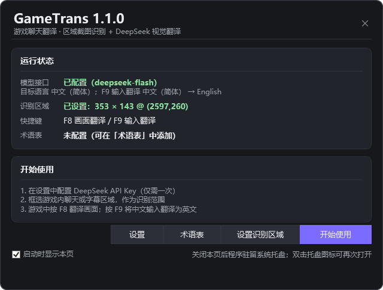
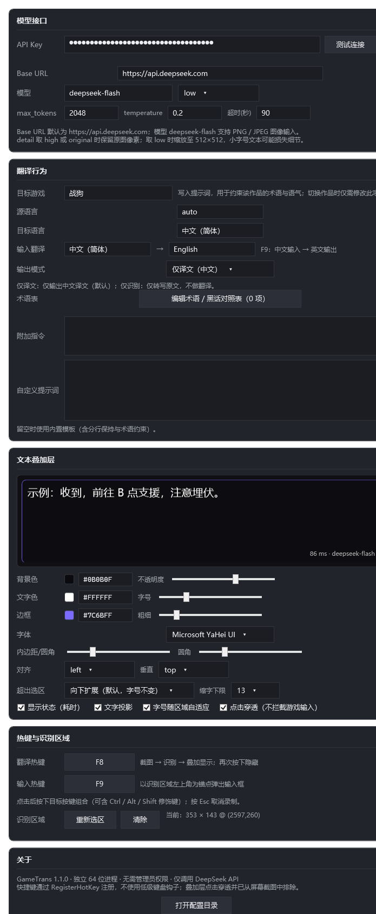
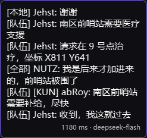
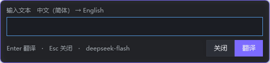
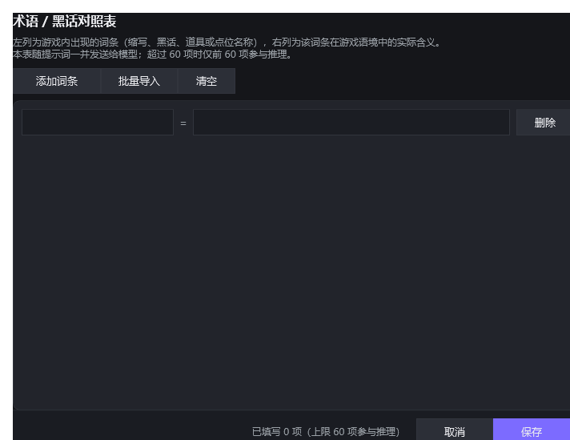

# GameTrans

面向 PC 游戏的实时聊天翻译工具。以屏幕指定区域为识别范围，按快捷键截图并交由 DeepSeek 视觉模型完成文字识别与翻译，结果以可配置样式的文本层叠加在原位显示；另提供输入翻译通道，将中文输入翻译为英文并写入剪贴板。

- 独立 64 位进程，单文件自包含发布，**无需管理员权限**
- 不依赖游戏客户端、账号体系或加速器组件
- 叠加层点击穿透、不抢占焦点，并从屏幕截图中排除（不会把译文再次识别）

## 功能概览

| 能力 | 说明 |
|---|---|
| 区域识别 | 全屏冻结截图 + 拖拽框选，支持多显示器与混合 DPI |
| 画面翻译 | 默认 `F8`：截图 → 视觉模型识别并翻译 → 叠加显示；再次按下隐藏 |
| 输入翻译 | 默认 `F9`：以识别区域左上角为锚点弹出输入框，中文输入翻译为英文 |
| 文本叠加层 | 背景色/透明度、文字色、字体字号、内边距、圆角、边框、对齐方式均可配置 |
| 溢出策略 | 文本超出识别区域时默认向下扩展（字号不变），可选缩放适配 |
| 术语表 | 手工维护「词条 → 含义」对照，随提示词下发以约束游戏内专有说法 |
| 启动页 | 汇总模型接口、识别区域、快捷键、术语表状态，并提供配置入口 |
| 无界面自检 | `--selftest` 校验配置、截屏、离屏渲染、请求体结构与提示词生成 |

## 界面

**启动页**



**设置**



**文本叠加层**（识别区域为 370 × 130 像素时的排版结果）



**输入翻译（F9）**



**术语 / 黑话对照表**



## 环境要求

- Windows 10 2004 或更高版本（叠加层依赖 `WDA_EXCLUDEFROMCAPTURE`）
- x64 架构
- 可用的 DeepSeek API Key（使用支持图像输入的模型，默认 `deepseek-flash`）

构建需要 [.NET 9 SDK](https://dotnet.microsoft.com/download/dotnet/9.0)；运行无需安装运行时（发布为自包含单文件）。

游戏建议使用**无边框窗口化**或窗口化模式。独占全屏（Exclusive Fullscreen）下系统截图通常为黑屏，且叠加层可能无法显示。

## 快速开始

1. 从 Releases 下载 `GameTrans.exe`。
2. 双击运行，启动页点击「设置」，填入 DeepSeek API Key，点击「测试连接」确认连通后保存。
3. 启动页点击「设置识别区域」，在游戏画面上框选聊天或字幕区域，按 Enter 确认。
4. 回到游戏：
   - 按 `F8` 翻译当前画面，再次按下隐藏；
   - 按 `F9` 输入中文，回车后译文写入剪贴板，转回游戏粘贴。

首次配置完成后，程序常驻系统托盘；托盘菜单可执行翻译、重新设置识别区域、打开术语表、设置与退出。

## 使用说明

### 画面翻译（默认 F8）

```
F8 ─┬─ 叠加层可见 ─────────────────────► 隐藏并取消进行中的请求
    └─ 不可见 ─┬─ 未设置识别区域 ──────► 打开选区，确认后继续
               └─ 已设置 ──────────────► 截取区域 → 叠加层显示「识别中…」
                                          → 视觉模型识别并翻译
                                          → 叠加层显示译文与耗时
```

- 叠加层以识别区域左上角为锚点，宽度与区域一致；译文高度超出时向下扩展。
- 请求失败时叠加层显示错误状态，不静默失败。

### 输入翻译（默认 F9）

```
F9 ─► 以识别区域左上角为锚点弹出输入框（半透明）
     ─► 输入中文 → Enter
     ─► 模型翻译为英文 → 写入剪贴板 → 输入框内显示译文
     ─► 3 秒后自动关闭（任意按键取消），Enter 可立即关闭
```

方向由「输入源语言 / 输入目标语言」决定，默认 `中文（简体） → English`，与画面翻译方向互不影响。

### 术语 / 黑话对照表

用于约束游戏内缩写、黑话、道具与点位名称的译法。

- 入口：启动页「术语表」、托盘菜单「术语 / 黑话对照表…」、设置页「术语表」。
- 左列填写词条，右列填写该词条在游戏语境中的含义。
- 支持批量导入：每行 `词条=含义`，亦接受 Tab 或 `|` 分隔。
- 存储上限 200 项，其中前 60 项参与提示词。

## 配置

配置目录：`%APPDATA%\GameTrans\`

| 文件 | 说明 |
|---|---|
| `settings.json` | 全部配置项 |
| `GameTrans.log` | 运行日志（超过 2 MB 时轮转） |

将 `portable.txt` 置于可执行文件同目录，或设置环境变量 `GAMETRANS_DATA`，可改用便携/自定义配置目录。

<details>
<summary>配置字段</summary>

| 分组 | 字段 | 说明 |
|---|---|---|
| `api` | `baseUrl` | 接口地址，默认 `https://api.deepseek.com` |
| | `model` | 模型名，默认 `deepseek-flash` |
| | `apiKeyProtected` | DPAPI 加密后的 API Key（由程序写入，勿手工填写明文） |
| | `detail` | `high` / `original` 保留原图细节；`low` 缩放至 512×512 |
| | `maxTokens` / `temperature` / `timeoutSeconds` | 默认 2048 / 0.2 / 90 |
| `prompt` | `gameName` | 目标作品名称，写入提示词以约束术语与语气 |
| | `sourceLanguage` / `targetLanguage` | 画面翻译方向，默认自动识别 → 中文（简体） |
| | `inputSourceLanguage` / `inputTargetLanguage` | F9 方向，默认 中文（简体） → English |
| | `outputMode` | `translated` 仅译文 / `ocr` 仅识别 |
| | `glossary` | 术语表，`{ term, meaning }` 数组 |
| | `extraInstruction` | 追加指令；`systemPrompt` 留空时使用内置模板 |
| `overlay` | `bgColor` / `bgOpacity` | 背景色与不透明度 |
| | `textColor` / `fontFamily` / `fontSize` | 文字样式 |
| | `padding` / `cornerRadius` / `borderColor` / `borderThickness` | 内边距、圆角、边框 |
| | `textAlign` / `verticalAlign` | 对齐方式 |
| | `showStatus` / `textShadow` | 耗时显示、文字投影 |
| | `autoScaleFont` / `minFontSize` | 字号自适应与下限 |
| | `overflowMode` | `expand` 向下扩展 / `shrink` 缩放适配 |
| | `clickThrough` | 点击穿透 |
| `hotkeys` | `translateVk` / `translateMods` | 画面翻译快捷键，默认 F8 |
| | `inputVk` / `inputMods` | 输入翻译快捷键，默认 F9 |
| `region` | `left` / `top` / `right` / `bottom` | 识别区域，虚拟桌面物理像素坐标 |
| `behavior` | `showStartupWindow` / `inputOpacity` | 启动页开关、输入框不透明度 |
| | `showLatency` / `copyInputResult` | 耗时显示、自动复制 |

</details>

## 工作原理

```
┌──────────────┐   RegisterHotKey    ┌──────────────┐
│ Win32 热键   │ ──────────────────► │  TrayApp     │
└──────────────┘                     └──────┬───────┘
                                            │
                    ┌───────────────────────┼────────────────────────┐
                    ▼                       ▼                        ▼
            ┌──────────────┐        ┌──────────────┐        ┌────────────────┐
            │ ScreenCapture│        │ DeepSeekClient│       │ OverlayWindow  │
            │ GDI BitBlt   │ ─────► │ chat/completions │ ───► │ 分层透明窗口   │
            └──────────────┘  PNG   └──────────────┘  文本  └────────────────┘
```

详见 [docs/DESIGN.md](docs/DESIGN.md)，包含截图坐标换算、叠加层窗口样式、提示词设计与已知限制。

## 构建与发布

```powershell
# 构建（解决方案，可用 Visual Studio 2022 / Rider 直接打开）
dotnet build GameTrans.sln -c Release

# 发布单文件（win-x64 / 自包含），并自动执行自检
powershell -ExecutionPolicy Bypass -File scripts/publish.ps1
```

发布产物位于 `dist/`，其中的 `GameTrans.exe` 为自包含单文件，可直接分发。

自检：

```powershell
dist\GameTrans.exe --selftest .\out
```

## 命令行参数

| 参数 | 说明 |
|---|---|
| `--selftest <目录> [--headless]` | 无界面自检，输出 `report.txt` 与中间产物；`--headless` 跳过屏幕相关检查（用于 CI） |
| `--set-key <API_KEY>` | 加密保存 API Key |
| `--api-test <API_KEY>` | 文本探针，验证接口连通性 |
| `--api-text <API_KEY> <文本>` | 按 F9 方向翻译指定文本 |
| `--api-vision <API_KEY> <图片>` | 对指定图片执行视觉翻译 |
| `--demo-startup <png>` | 启动页离屏渲染 |
| `--demo-glossary <png>` | 术语表离屏渲染 |
| `--demo-settings <png>` | 设置页整页离屏渲染 |
| `--demo-overlay <x> <y> <w> <h>` | 在指定位置显示叠加层 |
| `--demo-compose <png> <w> <h>` | 按指定区域尺寸排版并离屏渲染叠加层 |
| `--demo-input <png>` | 输入框离屏渲染 |
| `--demo-selector` | 短暂打开选区窗口用于验证 |

## 常见问题

**快捷键无响应**
快捷键已被其他程序占用。设置页保存时会提示注册结果，可改用带修饰键的组合（如 `Ctrl+Alt+F8`）。

**截图全黑 / 叠加层不显示**
游戏处于独占全屏模式，或画面受 DRM 保护。请切换至无边框窗口化。

**翻译结果字号过小**
确认「超出选区」为「向下扩展」，或在设置中调高字号、关闭「字号随区域自适应」。

**接口报错**
`401` Key 无效；`402` 余额不足；`429` 限流（客户端会自动重试一次）；超时请调高 `timeoutSeconds` 或缩小识别区域。

**多显示器与缩放**
坐标基于虚拟桌面物理像素；跨屏框选可用，各显示器按自身 DPI 换算。

## 隐私与安全

- API Key 使用 Windows DPAPI 加密存储，仅当前用户可解密。
- 截图仅在内存中编码为 PNG 并发送至所配置的模型接口，不写入磁盘。
- 程序不包含遥测、统计或更新检查。

## 免责声明

- 本项目与任何游戏发行商、加速器产品或模型服务商无隶属或合作关系。
- 交互形态参考了同类工具的通用做法，实现与代码均为独立编写。
- 使用本工具可能违反部分游戏的用户协议，请自行评估账号风险。
- 模型输出可能存在错误，调用产生的费用由使用者承担。

## 许可证

[MIT](LICENSE)
